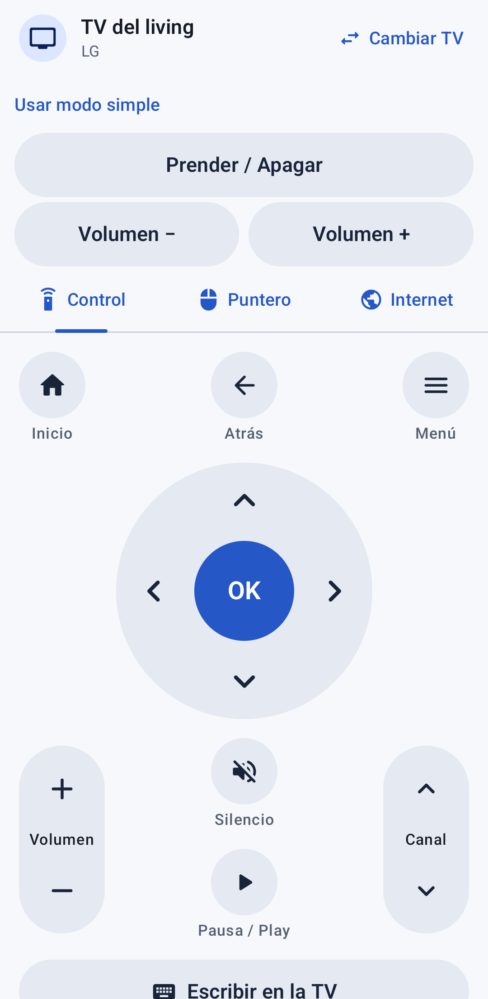
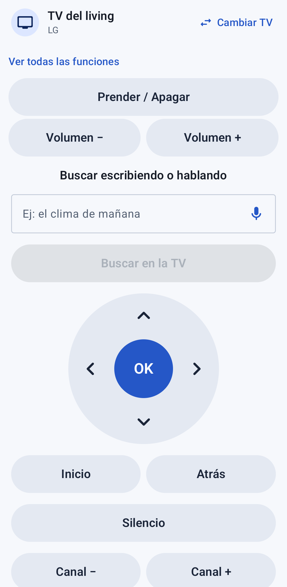
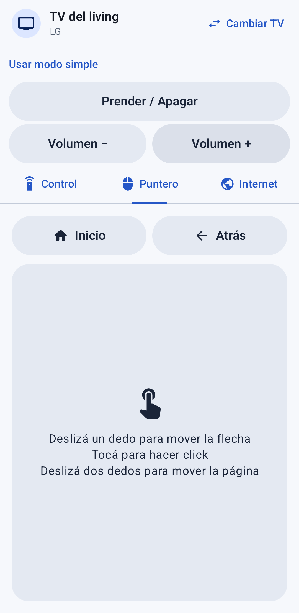

# ControlTv 📺

App de Android que convierte el teléfono en el **control remoto de tu Smart TV**, por WiFi.

## La idea

Los controles de las Smart TV son chicos, tienen demasiados botones y escribir con ellos es un
suplicio: buscar algo en YouTube o entrar a una página de internet letra por letra con las flechas
no lo hace nadie. Y menos una persona mayor.

ControlTv busca resolver eso con una app **muy simple e intuitiva**, pensada también para gente
grande:

- **Encuentra la TV sola.** Abrís la app y busca las TVs de tu WiFi. La próxima vez reconecta con un toque.
- **Botones grandes y con nombre.** Encendido y volumen siempre a mano en Control, Puntero e Internet.
- **Modo simple.** Una pantalla con lo esencial y búsqueda por voz; la elección queda guardada.
- **Internet fácil.** Buscás en Google o YouTube escribiendo en el teléfono, o directamente
  **hablando** 🎤. Hay páginas favoritas a un toque, las últimas búsquedas guardadas y botones para
  subir y bajar la página. Podés agregar, editar, quitar y ordenar tus favoritos, y borrar una búsqueda o todo el historial.
- **Mensajes claros.** Si algo falla, la app explica qué hacer en castellano simple, sin términos técnicos.

## Capturas

Interfaz en un emulador Android, con una TV simulada para las pruebas:

  

## Marcas compatibles

| Marca | Cómo se conecta | Qué hay que hacer la primera vez |
|---|---|---|
| **Samsung** (Tizen, 2016+) | WebSocket, puertos 8001/8002 | Aceptar el mensaje "¿Permitir?" en la TV |
| **LG** (webOS) | WebSocket SSAP, puertos 3000/3001 | Aceptar el mensaje en la TV |
| **Google TV / Android TV** (TCL, Hisense, Philips, Sony nuevas, Chromecast…) | Android TV Remote v2 (TLS + protobuf), puertos 6466/6467 | Escribir en el teléfono el código que muestra la TV |
| **Fire TV** y Android TV viejas | ADB por red, puerto 5555 | Activar la depuración (la app explica cómo, paso a paso) y aceptar "¿Permitir depuración?" |
| **Roku** (TCL, Hisense, onn, Philco…) | HTTP ECP, puerto 8060 | Activar *Control por apps móviles* en los ajustes |
| **Sony Bravia** | HTTP IP Control + IRCC, puerto 80 | Elegir una clave en *Ajustes > Red > Control IP* y escribirla en la app |

Las marcas se eligieron según las más vendidas (Samsung, TCL, Hisense, LG). Muchas TCL, Hisense
y otras traen Roku TV o Google TV adentro, así que quedan cubiertas.

> Roku no tiene navegador de internet: en esas TVs la app usa el buscador propio de la TV.

> Google TV usa el mismo protocolo que la app oficial "Google TV" del teléfono, basado en
> [androidtvremote2](https://github.com/tronikos/androidtvremote2) (Apache 2.0). No necesita modo desarrollador.

## Cómo está hecho

- **Kotlin + Jetpack Compose**, corrutinas para todo lo que usa red.
- **Clean Architecture** en tres capas, con principios **SOLID**:
  - `domain`: la lógica, en Kotlin puro (modelos, errores, interfaces, casos de uso).
  - `data`: cómo se habla con cada marca, la búsqueda en la red y lo guardado en el teléfono.
  - `ui`: pantallas y ViewModels.
- Cada marca vive en su propia carpeta (`data/tv/<marca>`) con su controlador y su detector,
  así sumar una marca nueva no obliga a tocar el resto.
- Errores tipados (`TvError`) que la UI traduce a mensajes simples.
- Librerías: OkHttp (HTTP/WebSocket), dadb (ADB), protobuf-lite (mensajes de Google TV, generados
  desde `app/src/main/proto`) y BouncyCastle (certificado del teléfono para Google TV).

Las reglas completas del proyecto (estilo, arquitectura, idioma, cómo agregar una marca) están en
[`CLAUDE.md`](CLAUDE.md).

## Compilar y probar

Abrir el proyecto en Android Studio, o desde la terminal:

```bash
./gradlew :app:assembleDebug        # genera el APK
./gradlew :app:testDebugUnitTest    # corre los tests
```

El teléfono y la TV tienen que estar en la **misma red WiFi**.

## Encender la TV por WiFi

La app aprende las direcciones MAC al conectar una TV prendida y las guarda en **Mis TVs**.
Si el modelo no las informa, tocá **Editar** en esa TV e ingresá la MAC de WiFi o de cable que
aparece en sus ajustes de red. Podés guardar ambas, separadas por una coma.

La TV debe seguir enchufada y tener activado el encendido por red. Según la marca se llama
*Encender con dispositivo móvil*, *Encender TV con móvil*, *Inicio rápido* o *Encendido remoto*.
La app envía Wake-on-LAN y también intenta el encendido directo si el modelo lo admite.
No se puede encender una TV desenchufada ni garantizar el encendido si su placa de red se apaga
por completo. Si falla, la app indica qué opción revisar en la TV.

## Detección y conexión

La búsqueda combina anuncios **SSDP** y un barrido de las IPs de la red; las TVs guardadas se
prueban primero. Usa la máscara real del WiFi o Ethernet para calcular la difusión de Wake-on-LAN.
En redes muy grandes el barrido se limita a los 1022 vecinos del segmento local; SSDP puede
aportar otras IPs y siempre queda disponible la entrada manual.

Si el router tiene una red de invitados o aislamiento entre dispositivos, conectá el teléfono
y la TV a la red principal y permití la comunicación entre ellos. La detección no puede evitar
un bloqueo del router.

El servicio de conexión funciona mientras hay una sesión de TV. No usa el modo WiFi de baja
latencia ni se reinicia por sí solo al perderse el proceso de la app.

## Identificador de la app

El identificador y el paquete son `ar.com.josemascherpa.controltv`.
Android lo considera una app distinta de `com.example.controltv`: si tenías la versión anterior,
vas a tener que conectar tus TVs y configurar tus preferencias nuevamente. No desinstales la
anterior hasta comprobar que tenés lo que necesitás.

La firma de versiones para distribución, GitHub Releases y las tiendas quedan para más adelante.

## Pruebas y contribuciones

```bash
./gradlew :app:testDebugUnitTest       # dominio, preferencias, controladores y ViewModel
./gradlew :app:lintDebug               # revisión estática de Android
./gradlew :app:connectedDebugAndroidTest  # interfaz; requiere emulador o teléfono
```

Las pruebas de red usan respuestas simuladas; la compatibilidad final y el encendido deben
validarse también con TVs físicas. Para contribuir, seguí la arquitectura, el idioma y los pasos
para agregar una marca de [CLAUDE.md](CLAUDE.md) y la guía [CONTRIBUTING.md](CONTRIBUTING.md).

## Compatibilidad pendiente

Hisense **VIDAA**, **Vizio SmartCast** y Philips con **Saphi/Titan/JointSpace** necesitan
implementaciones y validación específicas según el modelo. No están incluidas como marcas
compatibles nativas. Hisense y Philips con **Google TV / Android TV o Roku** ya se controlan
mediante esos protocolos.
